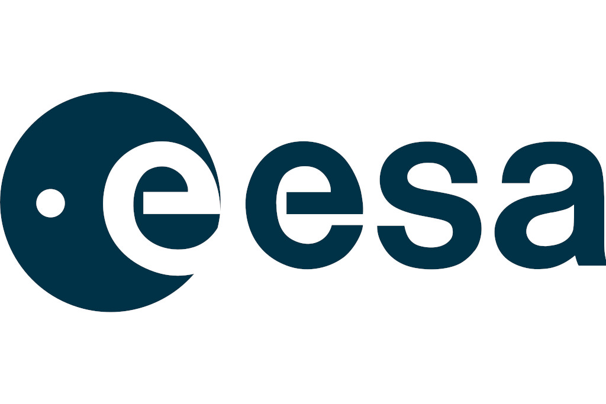
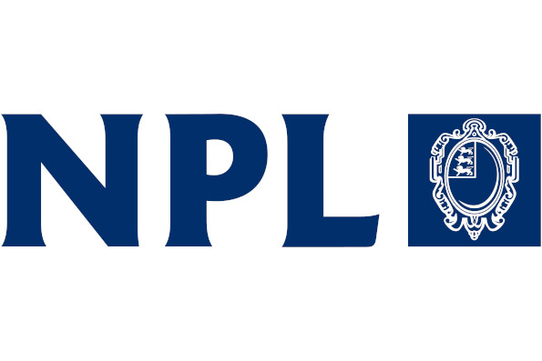
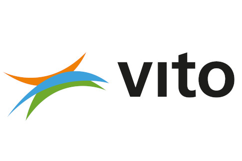

[](https://github.com/LIME-ESA/glodformat/tags)
[![License: LGPL 3.0][license-shield]][license-url]
[![Issues][issues-shield]][issues-url]
[![Stargazers][stars-shield]][stars-url]

<!-- PROJECT LOGO -->
<br />
<div align="center">
  <a href="https://lime.uva.es">
    
  </a>

  <h3 align="center">glodformat</h3>

  <p align="center">
    Reader and diagnostics toolkit for GLOD-based netCDF files.
    <br />
    <!--<a href="https://lime-esa.github.io/glodformat/"><strong>Explore the docs »</strong></a>-->
    <br />
  </p>
</div>


<!-- TABLE OF CONTENTS -->
<details>
  <summary>Table of Contents</summary>
  <ol>
    <li>
      <a href="#about-the-project">About The Project</a>
      <ul>
        <li><a href="#collaborators">Collaborators</a></li>
      </ul>
    </li>
    <li>
      <a href="#getting-started">Getting Started</a>
      <ul>
        <li><a href="#prerequisites">Prerequisites</a></li>
        <li><a href="#installation">Installation</a></li>
      </ul>
    </li>
    <li><a href="#usage">Usage</a></li>
    <li><a href="#roadmap">Roadmap</a></li>
    <li>
      <a href="#development-guide">Development Guide</a>
      <ul>
        <li><a href="#versioning">Versioning</a></li>
        <li><a href="#setting-up-the-environment">Setting Up the Environment</a></li>
        <li><a href="#testing">Testing</a></li>
      </ul>
    </li>
    <li><a href="#license">License</a></li>
    <li><a href="#authors">Authors</a></li>
  </ol>
</details>


## About the project

`glodformat` is a Python package that helps validate the format of netCDF files derived
from GLOD and other specifications.

This library was developed for the LIME Toolbox, under the LIME projects development efforts.
More information about LIME can be found on [lime.uva.es](https://lime.uva.es).

### Collaborators

The LIME project is managed, financed and supported by the European Space
Agency ([ESA](https://esa.int)).

The project is a collaboration between multiple institutions, including:
- [NPL](https://npl.co.uk) (National Physics Laboratory, United Kingdom)
- [UVa](https://uva.es) (Universidad de Valladolid, Spain)
- [VITO](https://vito.be) (Vlaamse Instelling voor Technologisch Onderzoek, Belgium)

## Getting started

### Prerequisites

- Python >= 3.10

### Installation

The package is available at PyPI and can be installed with:
```sh
pip install glodformat
```

Another option is installing the python package and its dependencies
directly from the cloned repository in editable mode by using:
```sh
pip install -e .
```

## Usage

```python
import glodformat

# Functions accept both paths or loaded xarray datasets
glodformat.validate_srf("response.nc")
glodformat.validate_moon_observation("moon_obs.nc")
glodformat.validate_srf_for_obs("response.nc", "moon_obs.nc")
```

## Roadmap

- [ ] Fully support checking if an observation file is correctly represented by a SRF file
- [ ] Add support for LIME Toolbox related formats

## Development Guide

### Versioning

Version changes and descriptions are stored in the <a href="./CHANGELOG.md">CHANGELOG</a>.
This file is updated each time a new version is released.

### Setting Up the Environment

To prepare your environment for development, testing or deployment, follow these steps:

1. **Install Pre-commit Hooks**
    Install the `pre-commit` hooks to automatically check code styling:
    ```sh
    pre-commit install  
    ```

    - When you commit changes, `black` will check your code for styling errors.
    - If errors are found, they will be corrected, and the commit will be aborted to allow you to review the changes.
    - If you're satisfied, reattempt the commit.

2. **Install Python Dependencies**

    Install the python package dependencies listed in the `requirements.txt` file, preferably in a python virtual enironment:
    ```sh
    pip install -r requirements.txt  
    ```

### Testing

Run the following commands to ensure the code works as expected:

1. **Unit Tests**  
    To perform unit tests:
    ```sh
    python3 -m unittest  
    ```


## License

Distributed under the LGPL-v3 License. See [LGPL v3](./LICENSE) for more information.


## Acknowledgements

* [Javier Gatón Herguedas](mailto:gaton@goa.uva.es) - [GOA-UVa](https://goa.uva.es)
* [Pieter De Vis](mailto:pieter.de.vis@npl.co.uk) - [NPL](https://npl.co.uk)
* [Stefan Adriaensen](mailto:stefan.adriaensen@vito.be) - [VITO](https://vito.be)
* [Jacob Fahy](mailto:jacob.fahy@npl.co.uk) - [NPL](https://npl.co.uk)
* [Ramiro González Catón](mailto:ramiro@goa.uva.es) - [GOA-UVa](https://goa.uva.es)
* [Carlos Toledano](mailto:toledano@goa.uva.es) - [GOA-UVa](https://goa.uva.es)
* [África Barreto](mailto:abarretov@aemet.es) - [AEMET](https://aemet.es)
* [Agnieszka Bialek](mailto:agnieszka.bialek@npl.co.uk) - [NPL](https://npl.co.uk)
* [Marc Bouvet](mailto:marc.bouvet@esa.int) - [ESA](https://esa.int)

---

<div align="center"mages/uva_sello.jpg">
<a href="https://esa.int"></a><a href="https://uva.es"></a><a href="https://npl.co.uk"></a><a href="https://vito.be" ></a>
</div>


[stars-shield]: https://img.shields.io/github/stars/LIME-ESA/glodformat.svg?style=for-the-badge
[stars-url]: https://github.com/LIME-ESA/glodformat/stargazers
[issues-shield]: https://img.shields.io/github/issues/LIME-ESA/glodformat.svg?style=for-the-badge
[issues-url]: https://github.com/LIME-ESA/glodformat/issues
[license-shield]: https://img.shields.io/github/license/LIME-ESA/glodformat.svg?style=for-the-badge
[license-url]: https://github.com/LIME-ESA/glodformat/blob/main/LICENSE
